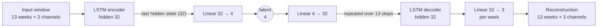

# Anomaly Detection — Supply Chain

Unsupervised demand anomaly detection on the public **M5 Walmart** dataset.
Spikes, drops, trend breaks and sustained regime changes are analyzed at the
SKU × Store × week grain so a planner can act before they cascade into a
stockout or overstock. Two complementary models (an Isolation Forest and an LSTM
autoencoder) are combined into a single consensus detector.

> ⚠️ **Data:** public M5 dataset only. No company data is used or versioned in
> this repository.

**Live demo (Cloud Run):** `https://anomaly-detection-sc-117719476260.europe-west1.run.app`
— an interactive timeline at `/`, a weekly triage queue at `/triage`, plus
`POST /score` and API docs at `/docs`.

---

## Problem

Demand planners cannot analyze tens of thousands of SKU × store series every
week. The goal is to automatically flag the weeks whose demand behaviour is
abnormal — with an honest, measurable notion of "abnormal" — so review effort
goes where it matters.

The task is **unsupervised** (no labels) and M5 is a real, noisy retail dataset.
Most of the engineering below is about making detection *measurable*, *honest*,
and *robust to the kind of anomaly* — which a planner cannot know in advance.

## Approach

| Step | Choice |
|---|---|
| Signal | Raw sales, fed to the models as **deviations / shape** (never absolute levels) |
| Grid | SKU × Store × week |
| Models | Isolation Forest (tabular) + LSTM autoencoder (sequence) → **consensus** |
| Evaluation | **Synthetic injection** of labeled anomalies |
| Primary metric | **Recall at a fixed false-positive budget** (PR-AUC secondary) |

## Pipeline

```
src/
  data/         daily -> weekly aggregation (PySpark)
  features/     contextual feature engineering
  evaluation/   synthetic injection + IF/AE/consensus evaluation
  models/       Isolation Forest, LSTM autoencoder
  serving/      FastAPI app
viz/            interactive timeline + triage dashboard (D3) and their data exports
                (export_series.py -> series_data.js, export_alerts.py -> alerts_data.js)

notebooks/
  01_eda.ipynb              EDA + density segmentation
  02_injection.ipynb        synthetic anomaly injection
  03_isolation_forest.ipynb IF training, evaluation, threshold, MLflow
  04_autoencoder.ipynb      AE training, evaluation, consensus
```

---

## Key EDA findings

Every feature decision is backed by a number, not intuition. Full analysis in
`notebooks/01_eda.ipynb`.

- **Weekly aggregation already reduces intermittency.** Zero-sales share is 39.7%
  at the weekly grain. After trimming cold-start zeros (weeks before a product's
  first sale — 21% of the raw grid), true demand intermittency is a moderate
  **23.9%**.
- **Density is a continuum, not two populations.** No bimodality, so the
  dense/sparse threshold is set by *evaluation need*, not by a natural gap: the
  rolling z-score (below) needs a well-defined local variance. **Dense pool =
  density ≥ 0.8 AND life ≥ 52 weeks → 15,509 series** across all three categories.

  For week $t$ of a series with weekly sales $y$, the rolling z-score is:

```math
z_t = \frac{y_t - \mu_t}{\sigma_t}, \qquad
\mu_t = \frac{1}{13}\sum_{i=1}^{13} y_{t-i}, \qquad
\sigma_t = \sqrt{\frac{1}{12}\sum_{i=1}^{13}\left(y_{t-i} - \mu_t\right)^2}
```

  The mean and standard deviation cover the 13 weeks *before* $t$, so an anomaly
  cannot inflate its own baseline. On a mostly-zero series $\sigma_t$ collapses
  and $z_t$ stops meaning anything, hence the density floor.
- **Seasonal deviation is computed per series, year-over-year.** The global
  seasonal profile mixes trend and fiscal-calendar effects (Walmart's fiscal
  year starts in February); a per-series N-1 comparison is robust to this by
  construction.
- **SNAP matters, but only for food.** FOODS sales rise ~19% with SNAP days;
  HOBBIES and HOUSEHOLD are flat. `snap_days` is kept with `cat_code`, letting
  the model learn the interaction.
- **No event feature survives scrutiny.** Super Bowl lift is +0.5% (noise); NBA
  Finals +3.3% once de-confounded from June seasonality — below any threshold.
  A fully data-justified rejection.

## Feature engineering

**Golden rule: no absolute levels fed to the models.** Raw sales are used only to
*compute* features; the models see deviations (IF) or per-series-normalized shape
(AE), so a high-volume store is not flagged just for being large.

The Isolation Forest's six features:

| Feature | Meaning |
|---|---|
| `sales_zscore` | Rolling 13-week z-score $z_t$ (formula above), computed on **prior weeks only** so an anomaly can't mask itself |
| `yoy_ratio` | Sales vs the same week one year earlier, per series |
| `wow_delta` | Week-over-week relative change |
| `snap_days` | SNAP days in the week (0–7) |
| `cat_code` | Encoded product category |
| `month` | Fiscal month |

**Scope note:** series have *variable* life spans — the dense pool admits
late-introduced products (density ≥ 0.8 is measured over a series' effective life
of ≥ 52 weeks, not since d_1). Within a series' active span the weeks are
gap-free, so rolling and YoY windows are calendar-exact by row position.
Evaluation and the IF cover the post-52-week zone (where the YoY feature exists);
the AE, which needs no YoY, can score earlier.

---

## Scoring method

Both models output an **anomaly score where higher = more anomalous**, and a week
is flagged when its score crosses an **operating threshold set from a
false-positive budget** (flag ~5% of clearly-normal weeks). The two scores are then combined into a consensus.

### 1 — Isolation Forest (tabular, point-in-time view)

**How the algorithm works.** An Isolation Forest does not model what normal
looks like; it measures how easy a point is to *isolate*. Each tree is grown on a
random subsample of $\psi = 256$ weeks: at every node it picks a random feature
and a random split value between that feature's min and max, and keeps splitting
until every point sits alone in a leaf. A normal week lies in a dense region and
needs many splits to be separated from its neighbours; an anomalous week sits
apart and is cut off after a few. The path length $h(x)$, the number of splits
from the root to $x$'s leaf, is therefore short for anomalies.

Averaged over the 200 trees and normalized by the expected path length of a
random binary search tree on $\psi$ points, this gives the anomaly score of the
original paper (Liu, Ting & Zhou, 2008):

```math
s(x) = 2^{-\,\mathbb{E}[h(x)] \,/\, c(\psi)}, \qquad
c(\psi) = 2H(\psi - 1) - \frac{2(\psi - 1)}{\psi}, \qquad
H(i) \approx \ln i + 0.5772
```

$s(x)$ tends to 1 for points isolated quickly and stays around 0.5 or below for
normal points. scikit-learn's `score_samples` returns $-s(x)$, so we negate it:
our anomaly score is $s(x)$ itself, **higher = more anomalous** (the operating
threshold lands at 0.55).

Two properties matter here. Splits are thresholds, so the model is insensitive
to feature scale and needs no normalization. And subsampling keeps training cheap
(about one second on 2.2M rows); anomalies are actually *easier* to isolate in
small samples, which is why $\psi = 256$ is the canonical setting.

- **Clipping.** The three derived features (`sales_zscore`, `yoy_ratio`,
  `wow_delta`) have heavy tails — a degenerate near-constant series can produce a
  z-score of 1000. Left unclipped, those extremes dominate the trees and blind
  the model to moderate anomalies. Each feature is clipped at its 99.9th
  percentile, **learned on training data and applied identically to evaluation
  and serving** (no leakage, no train/serve drift).
- **Decision.** The IF scores the full six-dimensional profile, so a point
  abnormal on one feature but normal on the others scores milder than a coherent
  shock across several.
- **Threshold.** The operating threshold is the score at the 95th percentile of
  clearly-normal weeks (a 5% false-positive budget).

### 2 — LSTM autoencoder (sequence, waveform view)

The AE sees a **13-week window** of three channels: per-series **normalized
sales** plus `sin`/`cos` of the week-of-year (so it knows the seasonal position).
An LSTM encoder compresses the window to a **4-dimensional latent**; a decoder
reconstructs it. The **reconstruction error on the sales channel is the anomaly
score**: the model learns to reconstruct *normal* window shapes, so a shape it
hasn't learned (a sustained level shift, a shock) reconstructs poorly.

**Architecture.**



| Layer | Output shape | Parameters |
|---|---|---|
| Input `[sales_norm, sin, cos]` | 13 × 3 | — |
| LSTM encoder (hidden 32), last hidden state kept | 32 | 4,736 |
| Linear → latent | 4 | 132 |
| Linear ← latent, repeated over the 13 steps | 13 × 32 | 160 |
| LSTM decoder (hidden 32) | 13 × 32 | 8,448 |
| Linear, applied at each step | 13 × 3 | 99 |
| **Total** | | **13,575** |

The encoder reads the window week by week and summarises it in its final hidden
state; the latent layer compresses that summary to 4 numbers; the decoder has to
rebuild the full window from those 4 numbers alone. Training minimises the MSE
over all three channels (Adam, learning rate $10^{-3}$, batch 512, ~774k windows
sampled at 50 per series, early stopping on validation loss). The anomaly score
uses the sales channel only, and is attached to the window's centre week:

```math
\text{score} = \frac{1}{13}\sum_{t=1}^{13}\left(\tilde y_t - \hat{\tilde y}_t\right)^2
```

where $\tilde y_t$ is the normalized sales and $\hat{\tilde y}_t$ its
reconstruction. The seasonal channels are deterministic and rebuilt almost
perfectly, so including them would only dilute the signal.

**Why median / IQR rather than mean / standard deviation.**

```math
\tilde y_t = \frac{y_t - \operatorname{median}(y)}{Q_3(y) - Q_1(y)}
```

The statistics that define "normal" must not be moved by the anomalies we are
trying to find, and a mean and standard deviation are: a single spike inflates
$\sigma$ and shrinks its own normalized deviation, and a level shift drags the
mean toward the new level. The median only moves if more than half the weeks
change, the quartiles if more than a quarter do, so a handful of abnormal weeks
leaves them almost untouched. Dividing by the IQR also puts series of 5 and 500
units a week on the same scale, in line with the no-absolute-levels rule.
Near-constant series (IQR ≈ 0) fall back to the standard deviation, then to 1.

**Why sin / cos of the week of year.**

```math
\theta = \frac{2\pi \cdot \text{week}}{52}, \qquad (\sin\theta,\ \cos\theta)
```

Without a seasonal reference the AE would flag the normal pre-holiday ramp as an
anomaly, the same trap the IF avoids with `yoy_ratio`. Week of year is cyclical,
so a raw integer is the wrong encoding: it puts week 52 and week 1 fifty-one
units apart when they are neighbours. Mapping it onto a circle fixes that. Both
coordinates are needed, because a sine alone gives the same value to two
different weeks (weeks 1 and 25, for instance); the (sin, cos) pair is unique
for every week, in two channels instead of 52 one-hot columns.

- **Global, non-adaptive normalization.** Each series is normalized by its own
  *global* median/IQR. This is the key design choice: a late level shift barely
  moves the global median, so the shifted weeks stay a visible offset. The IF's
  13-week *rolling* window, by contrast, adapts to the new level and absorbs the
  shift within ~13 weeks. Same data, two notions of "normal" — and this is why
  the AE catches sustained regime changes the IF goes blind to.
- **Tight bottleneck.** latent = 4 (< the 13 sales values) forces the AE to
  encode only the dominant normal structure. A wider latent (8, 16) reconstructs
  *everything* — including anomalies — so it has lower reconstruction error but
  **worse detection**: lower val loss, fewer anomalies caught. Capacity is tuned
  for discrimination, not reconstruction.
- **Threshold.** Reconstruction error at the 95th percentile of clean windows
  (same 5% budget).

### 3 — Consensus (combining the two)

The IF score and the AE error live on different scales, so each is converted to
its **percentile rank against clearly-normal weeks** (`p_if`, `p_ae` ∈ [0, 1],
1 = most anomalous). The **consensus score is `max(p_if, p_ae)`** — a single
ranked score: a spike (high `p_if`) or a level shift (high `p_ae`) both surface.
Flagging is at the same shared 5% FP budget.

Each alert also carries an **agreement tier**, from each model's own 5% flag:

- **both** — high confidence (the models agree)
- **if_only** — likely a point shock (the IF's turf)
- **ae_only** — likely a sustained regime change (the AE's turf)

The tiers give a planner a confidence level *and* a nature hint per alert. On
injected anomalies they are interpretable: spikes land in `if_only`/`both`, level
shifts in `ae_only`/`both` — and a level shift's onset lands in `if_only` while
its sustained plateau lands in `ae_only`, the absorption story made legible.

### Metric and honest negatives

**Recall** is the share of true anomalies a detector catches:

```math
\text{recall} = \frac{TP}{TP + FN}
```

On its own it means nothing, since flagging every week gives 100% recall. So the
threshold is fixed first, from a false-positive budget $\alpha$ on the set $N$ of
clearly-normal weeks, and recall is then measured on the set $P$ of injected
anomalies at that threshold:

```math
\tau_\alpha = Q_{1-\alpha}\big(\{\, s(x) : x \in N \,\}\big), \qquad
\text{recall}@\alpha = \frac{\big|\{\, x \in P : s(x) \ge \tau_\alpha \,\}\big|}{|P|}
```

With $\alpha = 5\%$, $\tau$ is the 95th percentile of normal-week scores: 5% of
normal weeks are flagged by construction, and recall says what share of real
anomalies make it into that same alert list.

The headline metric is **recall at a fixed FP budget**, not PR-AUC: at ~1:150
positive:negative imbalance, PR-AUC is mechanically low and hard to read. Recall
at a fixed FP rate answers *"within the alert budget a planner can triage, what
share of true anomalies do we catch?"*.

**Negatives are restricted to clearly-normal weeks (|z| < 2).** M5 contains
unlabeled natural anomalies (2.7% of weeks have |z| ≥ 3); without this filter the
models are penalised for correctly flagging them, collapsing every metric. The
trade-off, stated honestly: we measure separation from *clearly normal* weeks,
not from natural anomalies.

---

## Evaluation: synthetic injection

Because the task is unsupervised, performance is measured against anomalies we
inject ourselves (type and position known), then score and compare — the
analogue of an honest holdout. The models train on all dense series; **labels
never enter training**. Four types across severities k ∈ {2, 2.5, 3, 3.5, 4}.
Full walkthrough in `notebooks/02_injection.ipynb`.

Three validations confirm the injection mechanism behaves as intended:

- **Types exercise distinct features.** Spikes surface in the local z-score
  (recomputed z ≈ 3 at k=3); contextual anomalies stay hidden from it
  (mean |z| = 1.47) but explode in the YoY ratio (mean |yoy − 1| = 1.09).
- **Level shifts reproduce rolling-detector absorption.** Across the plateau the
  recomputed z-score decays 3.01 → 0.79: the IF flags the onset and goes blind to
  the persistence — the case for a sequence model.
- **Drop injection is volume-restricted** (mean − k·σ must stay > 0), so drop
  recall is measured on high-volume series — a documented scope limit.

---

## Results: IF vs AE vs consensus

Recall at a 5% FP budget (per type, k = 4):

| Type (k=4) | Isolation Forest | LSTM autoencoder | Consensus |
|---|---|---|---|
| spike | **81%** | 19% | 68% |
| level_shift | 26% | **62%** | 57% |
| contextual | 12% | 7% | 11% |
| drop | 19% | 10% | 12% |

- **Neither specialist is good at both.** The IF owns point shocks but is blind
  to sustained shifts (26%); the AE owns sustained shifts but misses spikes
  (19%). This complementarity is the payoff of the global-vs-rolling
  normalization difference.
- **The consensus is the robust single detector.** At the same 5% budget it is
  the only detector good on *both* classes (spike 68%, level_shift 57%). It can't
  dominate each type at a *shared* FP budget (a mathematical limit — the budget is
  split), but it has by far the best worst-case across the two classes a planner
  can't tell apart in advance (57% vs the IF's 26%, the AE's 19%).
- **Contextual and drop stay weak** across all three — neither model is strong
  there, and the consensus can't invent a signal that isn't in either. 

Thresholds come from a 5% alert budget. Training, evaluation and thresholds for
all three detectors are tracked in MLflow with recall logged by step = severity,
so the IF / AE / consensus curves overlay in the UI.

---

## Serving & deployment

The models are served as a FastAPI app on **Cloud Run** (europe-west1).

```bash
curl -X POST <url>/score -H "Content-Type: application/json" \
  -d '{"sales_zscore": 6.0, "yoy_ratio": 4.0, "wow_delta": 3.0,
       "snap_days": 2, "cat_code": 0, "month": 6}'
# -> {"anomaly_score": 0.63, "is_anomaly": true, "threshold": 0.55, ...}
```

- **Batch features / online scoring split.** The API scores a feature vector; it
  does not recompute features (a rolling z-score needs 13 weeks of history, the
  YoY ratio 52). Feature engineering stays in the batch pipeline; the API is the
  online scoring layer.
- **Standalone bundles, no MLflow at runtime.** Each model loads its own artifacts
  (IF: `model.pkl` + `clip_bounds.json` + `threshold.json`; AE: `model.pt` +
  `config.json`). Verified: reloaded scores match local exactly (train/serve
  parity).
- **Interactive timeline** (`/`, D3): pick a SKU × store series and see weekly
  sales with both models' flags overlaid — including a controlled injected
  level shift that makes the IF-vs-AE contrast visible.
- **Weekly triage queue** (`/triage`, D3): for each of the last 12 scorable
  weeks, every dense series is scored by both models and alerts are ranked by the
  consensus score. Each alert carries its tier (both / IF only / AE only), the
  two models' percentiles, a 12-month sparkline, and an expandable detail view.
  ~6–9% of series-weeks are flagged (calibration is on clearly-normal weeks; real
  weeks include natural anomalies). AE-only alerts are a steady background
  (~330/week) while IF-only alerts peak on calendar weeks. In production the
  alert budget would be tightened or weighted by SKU criticality.
- **Scale-to-zero** keeps idle cost ~nil; the first request after idle has a
  cold-start delay. 
  
## Stack

Python · PySpark (local mode) · scikit-learn · PyTorch · MLflow · FastAPI ·
Docker · GCP Cloud Run · D3.js

## Status & roadmap

**Complete.** Isolation Forest, LSTM autoencoder and a consensus layer, each
evaluated on the same injection harness and tracked in MLflow, served live on
Cloud Run with an interactive timeline and a weekly triage dashboard.

- [x] Phase 1 — EDA + weekly aggregation + density segmentation
- [x] Phase 2 — Contextual feature engineering
- [x] Phase 3 — Synthetic injection + metrics harness
- [x] Phase 4 — Isolation Forest + evaluation + MLflow
- [x] Phase 5 — FastAPI + Cloud Run *(publishable MVP milestone)*
- [x] Phase 6 — LSTM autoencoder + IF-vs-AE comparison
- [x] Phase 7 — Consensus layer + agreement tiers
- [x] Phase 8 — Weekly triage dashboard (alerts ranked by consensus, tagged by tier)
- [ ] ~~Phase 9 — Pub/Sub stream simulation~~ — **considered, dropped.** Demand
  here is weekly, and anomaly review in S&OP runs on a weekly cadence: data lands,
  the queue is scored, planners triage. Streaming would add infrastructure without
  changing what a planner sees or when. The fitting architecture is a scheduled
  weekly batch job (e.g. Cloud Scheduler → Cloud Run job re-running the export).
  Real-time scoring would also need the autoencoder retrained on trailing windows,
  since its centred 13-week window lags the latest data by 6 weeks.
